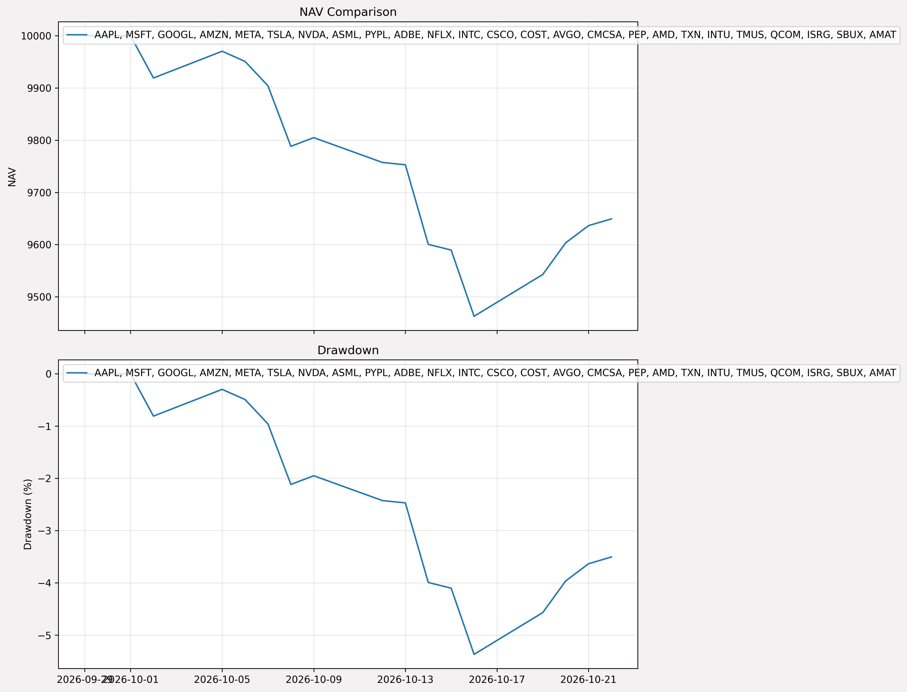

# Paper Trading Report

## Configuration

| Parameter | Value |
|-----------|-------|
| **Start Date** | 2026-10-01 |
| **Universe** | Current NQ25 |
| **Model** | trader-transformer-v20 |
| **Status** | In Progress |

---

## Performance (Live)

| Metric | Value |
|--------|-------|
| Total Return | -3.51% |
| Sharpe Ratio | -5.69 (Period=11 少過 20 日) |
| Max Drawdown | -5.37% |
| Win Rate | 0.00% |
| Total Trades | 7 |
| Open Positions | 11 |

*Period: 2026-09-29 → 2026-10-22*
*Last updated: 2026-10-23 13:18*

---

## Charts

---

## Trade Log

[View trade log](../reports/paper_trade_trx.xlsx)

[View pending orders](../reports/pending_orders.csv)

---

*Last update: 2026-10-06*
